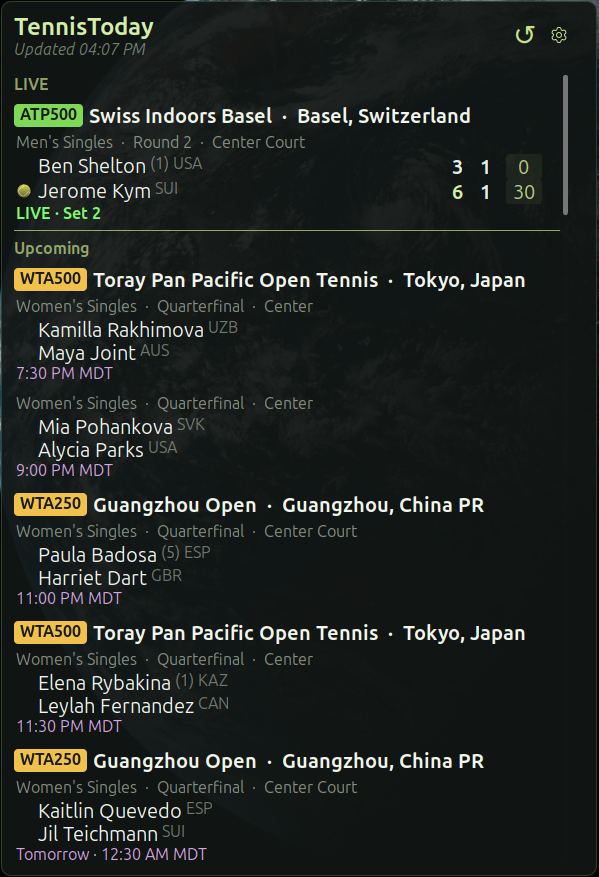

# TennisToday

Live ATP and WTA tennis scores on your Cinnamon desktop.



- Live, upcoming and recently finished matches, grouped by tournament
- Set scores, tiebreaks, current game points and who is serving
- Tournament level in the tag: `ATP500`, `WTA250`, `WTA125`, Grand Slam
- Filter by tour, level (1000, 500, 250, 125) and doubles
- Seeds, rounds, courts and countries where available
- Click a match to open it on LiveScore

## Install

```bash
git clone https://github.com/greyster1/TennisToday.git ~/src/TennisToday
mkdir -p ~/.local/share/cinnamon/desklets
ln -s "$HOME/src/TennisToday/TennisToday@greyster1/files/TennisToday@greyster1" \
  ~/.local/share/cinnamon/desklets/TennisToday@greyster1
```

Restart Cinnamon (**Ctrl+Alt+Esc**), then add TennisToday under
**System Settings → Desklets**. `git pull` updates it in place.

## Data

Matches, scores, levels and game points come from LiveScore's public feed;
seeds, rounds, courts and countries come from ESPN's. Both are unofficial and
may change without notice. If one is unreachable the desklet degrades rather
than stops.

More detail on settings is in [TennisToday@greyster1/README.md](TennisToday@greyster1/README.md).

## License

[GPL-3.0-or-later](TennisToday@greyster1/LICENSE)
